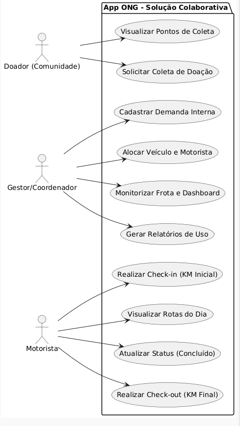
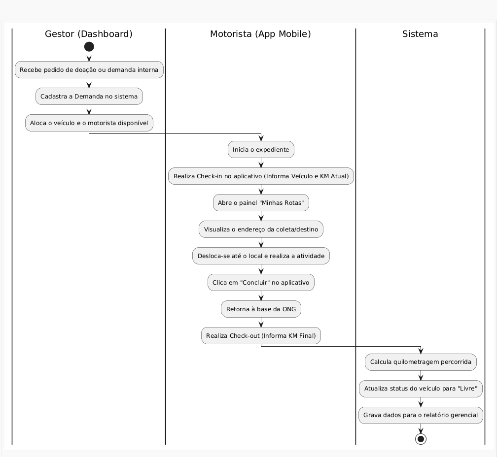
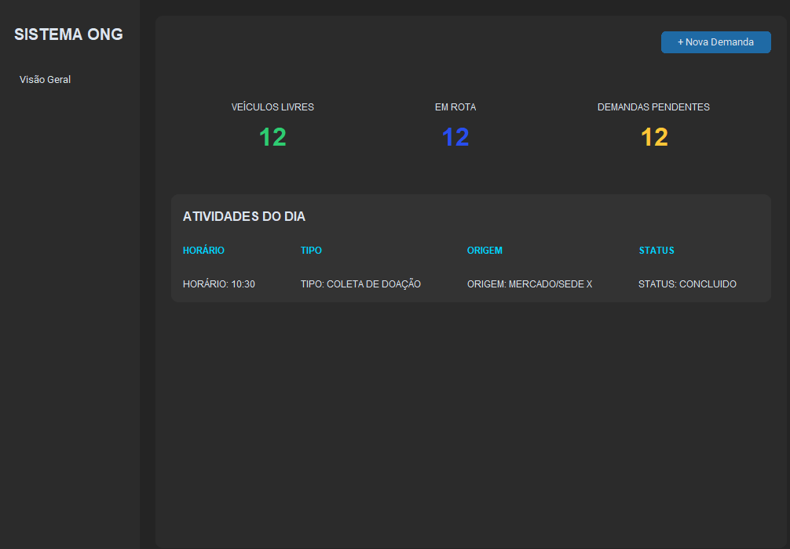

# 🚚 App de Gestão Logística - ONG Família Feliz

[-orange>)](#)

Uma solução móvel desenvolvida para otimizar a gestão de frota, rotas de coleta e deslocamentos diários de uma rede de acolhimento social em Blumenau/SC.

## 🎯 O Problema

A instituição precisava de um sistema centralizado para organizar o uso de seus veículos. O desafio principal era conectar, de forma eficiente, as solicitações diárias dos educadores (como transporte para postos de saúde ou coletas de doações) com a execução dos motoristas, além de fornecer relatórios precisos de uso para a gestão.

## 🚀 Status e Evolução do Projeto

Estou conduzindo este projeto de ponta a ponta. Após a validação do fluxo visual, o projeto avançou para a estruturação do backend e da base de dados.

**Progresso:**

**Progresso:**

- [x] Levantamento de Requisitos e validação de wireframes.
- [x] Modelagem da Base de Dados (DER) e implementação em SQLite.
- [x] **Mapeamento de Processos (UML): Casos de Uso e Diagrama de Atividades.**
- [x] **Desenvolvimento da Interface Gráfica (UI) do Painel de Gestão utilizando Python e CustomTkinter.**
- [ ] Integração final entre Interface (Front-end) e Base de Dados (Back-end).

## 🖼️ Wireframes e Fluxo de Uso

Abaixo estão os protótipos de baixa fidelidade criados para alinhar as expectativas e garantir a melhor usabilidade para a equipe da ONG antes do desenvolvimento.

## 🗄️ Arquitetura e Base de Dados

Para suportar o fluxo de informação em tempo real, a base de dados foi estruturada utilizando **SQLite**. A lógica de controle de frota está sendo desenvolvida em **Python**, aplicando Programação Orientada a Objetos (POO).

As tabelas principais relacionam os motoristas, os veículos e o histórico de utilização (Check-in/Check-out):

## 🖼️ Fluxo de Utilização (Protótipo Atualizado)

Abaixo encontra-se o fluxo de baixa/média fidelidade aprovado para garantir a melhor usabilidade para a equipa da ONG.

## 📐 Engenharia de Software (UML)

Para garantir que todas as regras de negócio fossem respeitadas antes de escrever a interface, o sistema foi mapeado utilizando diagramas UML:

**Diagrama de Casos de Uso:**
Mapeia as interações entre os atores principais: Doador (Comunidade), Gestor/Coordenador e Motorista.

**Diagrama de Atividades:**
Detalha o fluxo de uma demanda de transporte, desde o recebimento do pedido pelo Gestor, passando pelo check-in do Motorista no aplicativo, até a gravação dos dados para o relatório final pelo Sistema.

## 💻 Interface Gráfica (Painel do Coordenador)

O desenvolvimento da interface de gestão já foi iniciado. A aplicação desktop foi construída em **Python**, utilizando a biblioteca **CustomTkinter** para entregar um visual moderno (Dark Mode) e responsivo.

O dashboard permite a visualização rápida de:

- Veículos Livres
- Veículos em Rota
- Demandas Pendentes
- Tabela de Atividades do Dia em tempo real

