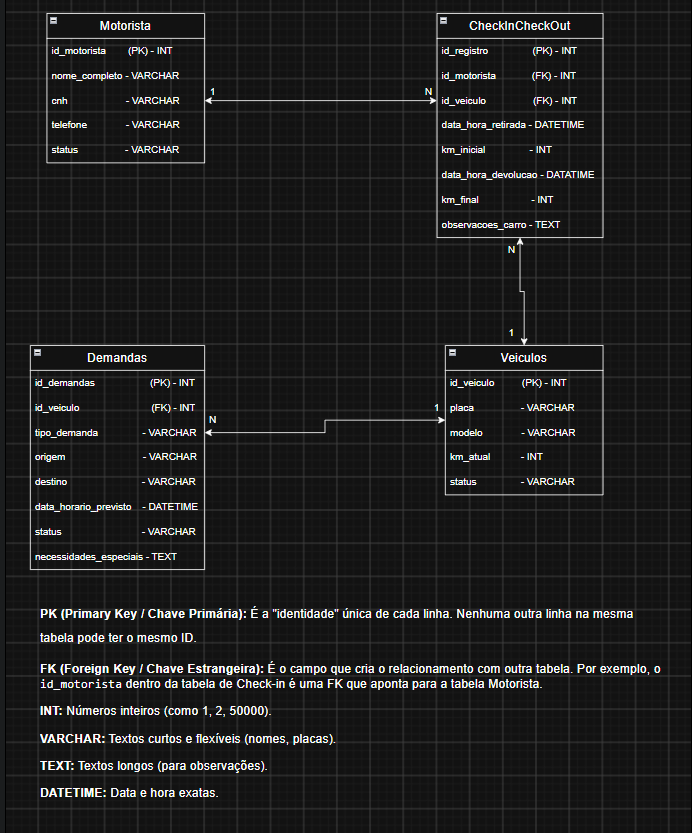
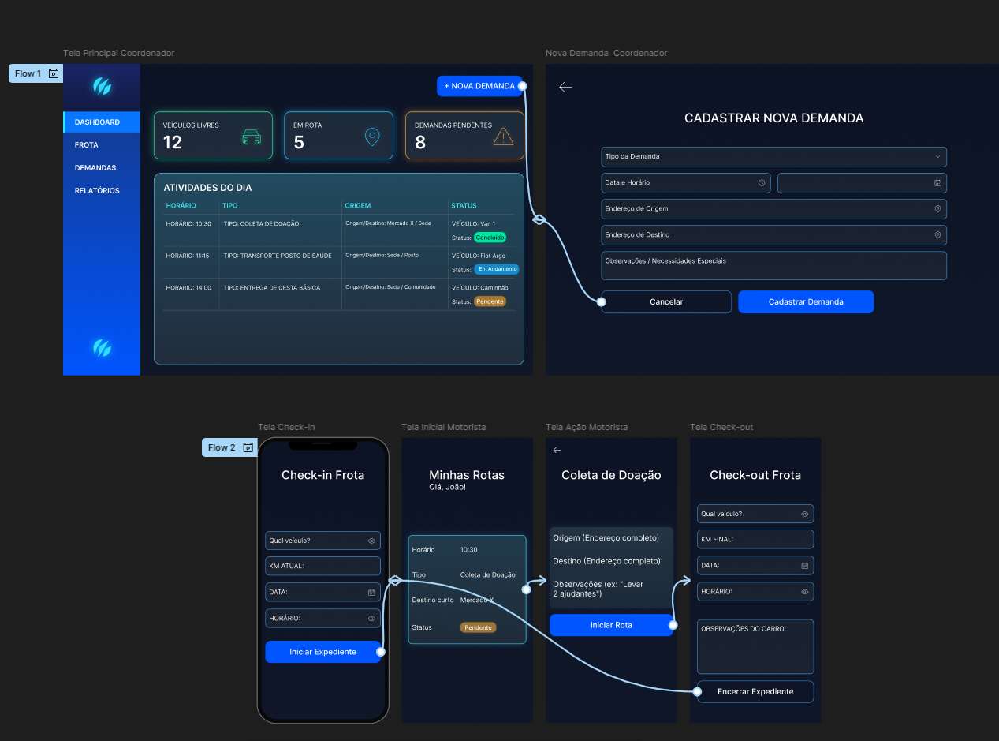

# 🚚 App de Gestão Logística - ONG Família Feliz

[-orange>)](#)

Uma solução móvel desenvolvida para otimizar a gestão de frota, rotas de coleta e deslocamentos diários de uma rede de acolhimento social em Blumenau/SC.

## 🎯 O Problema

A instituição precisava de um sistema centralizado para organizar o uso de seus veículos. O desafio principal era conectar, de forma eficiente, as solicitações diárias dos educadores (como transporte para postos de saúde ou coletas de doações) com a execução dos motoristas, além de fornecer relatórios precisos de uso para a gestão.

## 🚀 Status e Evolução do Projeto

Estou conduzindo este projeto de ponta a ponta. Após a validação do fluxo visual, o projeto avançou para a estruturação do backend e da base de dados.

**Progresso:**

- [x] Levantamento de Requisitos iniciais.
- [x] Esboço v1 construído e apresentado.
- [x] Pivotagem pós-feedback: Adição de dashboard para monitorização em tempo real.
- [x] **Aprovação do fluxo visual (Wireframes atualizados).**
- [x] **Modelagem da Base de Dados (DER) e implementação em SQLite.**
- [x] **Criação da lógica inicial de Backend (Python/POO) para Check-in/Check-out.**
- [ ] Início do desenvolvimento da Interface do Utilizador (UI) em alta fidelidade.

## 🖼️ Wireframes e Fluxo de Uso

Abaixo estão os protótipos de baixa fidelidade criados para alinhar as expectativas e garantir a melhor usabilidade para a equipe da ONG antes do desenvolvimento.

## 🗄️ Arquitetura e Base de Dados

Para suportar o fluxo de informação em tempo real, a base de dados foi estruturada utilizando **SQLite**. A lógica de controle de frota está sendo desenvolvida em **Python**, aplicando Programação Orientada a Objetos (POO).

As tabelas principais relacionam os motoristas, os veículos e o histórico de utilização (Check-in/Check-out):

## 🖼️ Fluxo de Utilização (Protótipo Atualizado)

Abaixo encontra-se o fluxo de baixa/média fidelidade aprovado para garantir a melhor usabilidade para a equipa da ONG.

## 🗺️ Próximos Passos (Roadmap)

- [ ] Criação do Design de Interface (UI) em alta fidelidade.
- [ ] Integração do backend em Python com a interface móvel.
- [ ] Implementação do módulo de relatórios e exportação de dados.
